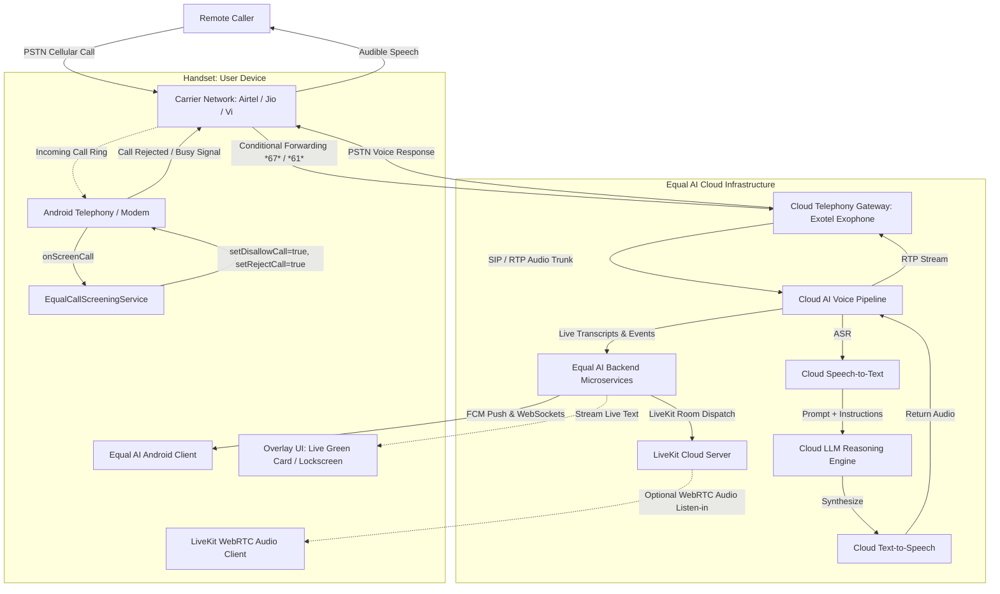
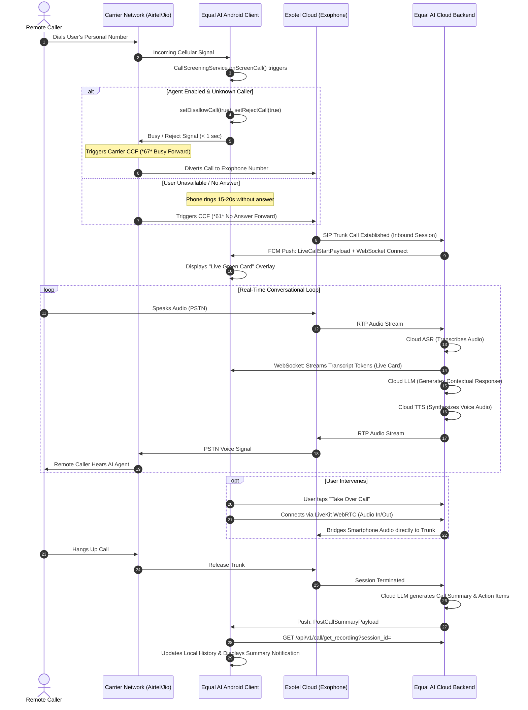

# Equal AI – Call Assistant: Comprehensive Architectural Investigation

**Analysis Target:** Equal AI – Call Assistant (`in.equal.ai.assistant`)  
**Package Version:** `2026.09.23` (VersionCode: `2026092376`)  
**Target SDK:** 36 | **Min SDK:** 29 (Android 10)  
**Investigation Date:** 2026-10-12  
**Analysis Author:** AI_CALL Engineering & Security Research Team  
**Artifact Directory:** `C:\Users\chiru\Downloads\EqualAI_Analysis\`

---

## 1. Executive Summary

A deep static analysis and reverse-engineering investigation was performed on the supplied XAPK package `in.equal.ai.assistant_2026.09.23 (1).xapk` to determine how the application connects to remote callers, delivers two-way voice, and whether any architectural mechanisms or components can resolve our ongoing `AI_CALL` native cellular audio injection blocker.

### Key Conclusions

1. **Equal AI is NOT an On-Device Cellular Audio Solution:**  
   Equal AI does **not** capture or inject audio into the handset's cellular baseband or Android Telecom InCallService. It does not possess a private or undocumented API to route audio between the microphone/speaker and the active cellular call.
2. **Call Routing via Carrier Conditional Call Forwarding (CCF):**  
   Equal AI operates by configuring carrier-level Conditional Call Forwarding (CCF) via automated GSM USSD/MMI codes (`**67*`, `**61*`, `**62*`, `**21*`). When the user's phone is busy, unanswered, or screened, the carrier network (Airtel, Jio, Vi) diverts the incoming cellular call to a cloud virtual phone number (an **Exophone**, hosted on Exotel's Indian cloud telephony infrastructure).
3. **Voice Processing Occurs Exclusively in the Cloud:**  
   The call is answered on Exotel/Equal AI's cloud servers. Speech recognition (ASR), LLM conversation reasoning, and text-to-speech (TTS) execute 100% on cloud infrastructure. Zero ML models (no Whisper, no on-device LLM, no ONNX/TFLite weights) exist in the APK.
4. **Android App Functions as a Real-Time Companion / Control Plane:**  
   While the cloud agent speaks with the remote caller over carrier telephony trunks, the Android app receives cloud events via FCM and WebSockets (`wss://user.ai-prod.equal.in/`). It renders floating overlays ("Live Green Card", lockscreen caller ID) using `SYSTEM_ALERT_WINDOW` and streams real-time transcript tokens. Optionally, the user can listen in or intervene using **LiveKit WebRTC** (`liblkjingle_peerconnection_so.so`).
5. **Commercial Cloud SaaS Dependency:**  
   The application requires constant internet connectivity, active backend microservices, third-party telephony provider subscriptions (Exotel), and monetizes via Razorpay payment gateways for subscription tiers.

---

## 2. System Component Decomposition



### 2.1 Android Client Architecture

The Android application is built with modern Android patterns:
- **Framework:** Kotlin, Jetpack Compose, Coroutines, StateFlow, Kotlinx Serialization, and Moshi/Gson.
- **Dependency Injection:** Hilt / Dagger.
- **Background Tasks:** Android WorkManager (`ExophoneMigrationWorker`, `SnoozeExpiryWorker`, `ContactNameUpdateWorker`).
- **Telemetry & Logging:** Sentry (`libsentry.so`, `libsentry-android.so`), Timber, Statsig feature flagging, Mixpanel, AppsFlyer.
- **UI Components:**
  - `LockscreenCallerIdOverlayServiceV3`: Lockscreen overlay rendering caller identity.
  - `CallManagerOverlayService`: Floating overlay window ("Live Green Card") managing in-progress call monitoring.
  - `MissedCallOverlayService` & `PostCallSummaryService`: Post-call notifications and action cards.
  - Lottie animation assets for voice orbs (`res/raw/voice_orb_ravi_blue.lottie`, `voice_orb_green.lottie`).

### 2.2 Telephony Integration Layer

The application interacts with Android telephony through two primary public subsystems:

1. **`android.app.role.CALL_SCREENING` (`EqualCallScreeningService`):**
   - Implements `android.telecom.CallScreeningService`.
   - Manifest declaration:
     ```xml
     <service android:name="in.equal.ai.assistant.callservices.EqualCallScreeningService"
              android:permission="android.permission.BIND_SCREENING_SERVICE">
         <intent-filter>
             <action android:name="android.telecom.CallScreeningService"/>
         </intent-filter>
     </service>
     ```
   - Purpose: When a call arrives, Android gives Equal AI up to 5 seconds to screen the caller. Equal AI evaluates caller rules and can call:
     - `CallResponse.Builder().setDisallowCall(true).setRejectCall(true).build()`
   - **Crucial Behavior:** Rejecting the call in `CallScreeningService` does **not** hang up the caller permanently. Instead, it signals the mobile network that the phone is "Busy" or "Declined", triggering carrier Conditional Call Forwarding (`*67*`) to route the call immediately to the cloud assistant without the user having to listen to the phone ring!

2. **`android.telephony.TelephonyManager` & `SubscriptionManager` (`UssdManager`):**
   - Requests `CALL_PHONE`, `READ_PHONE_STATE`, `READ_PHONE_NUMBERS`.
   - Executes USSD MMI commands using `TelephonyManager.sendUssdRequest()`.
   - Detects dual-SIM slots, carrier operator codes (MCC/MNC), and subscription IDs.
   - Monitors call state transitions (`TelephonyCallback.CallStateListener`).

### 2.3 Carrier Call Forwarding & Exophone Management

The application manages carrier call forwarding through dedicated modules:
- `in.equal.ai.assistant.onboarding.callforwarding`:
  - `CallForwardingVerifiedV2Request`, `CallForwardingVerifiedV2Response`, `CallForwardingVerifiedV2StepResult`.
- `in.equal.ai.assistant.exophonemigration`:
  - `ExophoneMigrationWorker`, `ExophoneMigrationResultRequest`, `ExophoneMigrationAction`.
- `in.equal.ai.assistant.model`:
  - `ForwardingCodes`, `MigrationForwardingCodes`, `CarrierRulesConfig`.

#### What is an "Exophone"?
In the Indian cloud telephony ecosystem, an **Exophone** is a virtual phone number (DID / virtual mobile number) provisioned on **Exotel**, the cloud telephony infrastructure company.  
Equal AI assigns a virtual number (`exophoneNumber`) to the user. All user calls are forwarded to this Exophone.

#### Automated GSM MMI Setup
The app attempts automated dialing of GSM MMI forwarding codes via `sendUssdRequest()`:
- Unconditional Forwarding: `**21*<Exophone>#`
- Forward when Unanswered / No Reply: `**61*<Exophone>#`
- Forward when Unreachable / Out of Coverage: `**62*<Exophone>#`
- Forward when Busy: `**67*<Exophone>#`
- Cancellation / Reset: `##002#`

#### Carrier-Specific Adaptations
- **Airtel & Vi (Vodafone Idea):** Supports standard automated USSD setup (`airtelPrimary`, `airtelSecondary`).
- **Jio:** Reliance Jio restricts automated USSD MMI forwarding on many 4G/5G SIM profiles. Equal AI displays a fallback prompt: `"Call Jio customer care to activate call forwarding"` or instructs manual dialing (`*401*<Exophone>`).
- **BSNL:** BSNL lacks reliable conditional forwarding on prepaid lines. The APK contains the explicit string:  
  `"BSNL does not support call forwarding. Please use a different carrier."`

### 2.4 Real-Time Media & Voice Streaming Layer (LiveKit WebRTC)

- **Bundled Engine:** `config.arm64_v8a.apk` bundles `liblkjingle_peerconnection_so.so` (12,073,512 bytes).
- **LiveKit SDK:** Full LiveKit Android client (`io.livekit.android:livekit-android`).
- **Classes:**
  - `io.livekit.android.room.types.AgentSdkState`
  - `io.livekit.android.token.RoomAgentDispatch`
  - `io.livekit.android.token.RoomConfiguration`
  - Endpoints in strings: `.livekit.cloud`, `.livekit.run`.
- **Function:**  
  LiveKit is **not** connected to the cellular baseband. LiveKit provides a WebRTC audio channel connecting the Android app to the cloud server room. This allows the smartphone user to:
  1. Listen in real time to the audio of the call while the cloud agent is speaking with the remote caller.
  2. "Barge in" or talk through the smartphone mic into the WebRTC room, which the cloud bridge patches into the telephone trunk to take over the call from the AI agent.

### 2.5 Cloud Backend Microservices

Equal AI operates production cloud services under `*.ai-prod.equal.in`:
- `https://user.ai-prod.equal.in/`: User accounts, session management, call recordings.
  - Endpoint: `/api/v1/call/get_recording?session_id=`
  - Real-time WebSocket: `wss://user.ai-prod.equal.in/`
- `https://billing.ai-prod.equal.in/`: Subscription tiers, paywalls, and plan quotas.
- `https://user-contact.ai-prod.equal.in/`: Contact synchronization and whitelist/blacklist rules.
- `https://user-events.ai-prod.equal.in/`: Telemetry, analytics, and screening network timelines.
- `https://api.razorpay.com/`: Payment gateway checkout and recurring billing.

---

## 3. End-to-End Call Lifecycle Trace

The observable architecture reveals the following sequence for every handled call:



---

## 4. Evidence Classification Table

Every finding is categorized by evidence standard:

| Finding | Evidence Level | Concrete Artifact Evidence |
|---|---|---|
| **Carrier Call Forwarding (CCF) is the primary call route** | **Confirmed by Direct Artifact Evidence** | DEX strings: `**67*`, `**61*`, `**62*`, `**21*`, `##002#`, `ForwardingCodes`, `CallForwardingVerifiedV2Request`, `CarrierRulesConfig`. |
| **Exophone (Exotel) Virtual Numbers Used** | **Confirmed by Direct Artifact Evidence** | DEX classes: `ExophoneMigrationWorker`, `ExophoneMigrationResultRequest`, `ExophoneMigrationAction`, strings: `exophoneNumber`, `newExophone`. |
| **CallScreeningService is used to reject/forward calls** | **Confirmed by Direct Artifact Evidence** | `EqualCallScreeningService` in manifest, DEX strings: `setDisallowCall`, `setRejectCall`, `setSilenceCall`, `screening service rejectCall::`. |
| **App is NOT a Default Dialer** | **Confirmed by Direct Artifact Evidence** | Manifest audit: Zero `InCallService`, zero `android.permission.BIND_INCALL_SERVICE`, zero `android.app.role.DIALER` declarations. |
| **LiveKit WebRTC client bundled** | **Confirmed by Direct Artifact Evidence** | `liblkjingle_peerconnection_so.so` (12 MB) in `config.arm64_v8a.apk`, package `io.livekit.android`, endpoints `.livekit.cloud`. |
| **No on-device ASR / TTS / LLM models** | **Confirmed by Direct Artifact Evidence** | Zero `.tflite`, `.onnx`, `.bin`, `.gguf`, or Whisper weight files in APK assets or native libraries. |
| **Cloud-based Backend Dependencies** | **Confirmed by Direct Artifact Evidence** | DEX hostnames: `billing.ai-prod.equal.in`, `user.ai-prod.equal.in`, `user-contact.ai-prod.equal.in`, `user-events.ai-prod.equal.in`. |
| **Razorpay Commercial Billing** | **Confirmed by Direct Artifact Evidence** | `com.razorpay.MagicXActivity`, `rzp_config_checkout.json`, `paywall_coin_rupee.json`, `api.razorpay.com`. |
| **Cloud AI Stack Implementation Details** | **Unknown from Available Files** | Server-side LLM model choice (OpenAI, Anthropic, Gemini, or vLLM), server-side TTS engine (ElevenLabs, Cartesia, Deepgram) are hosted remotely. |

---

## 5. Architectural Implications for AI_CALL

1. **Equal AI has NOT solved on-device cellular audio injection:**  
   The central technical blocker in `AI_CALL` is that Android OS isolates baseband audio from userspace apps during a native cellular call. Equal AI does not have a magic Android API or bypass for this; **it avoided the problem entirely** by moving the voice path to a cloud PBX (Exotel).
2. **The "Same-Number" illusion is achieved through Carrier Forwarding:**  
   Callers dial the user's normal number. Because the carrier forwards the call before the user answers (or immediately upon CallScreening rejection), the caller never realizes they are speaking to a cloud Exophone trunk.
3. **Implications for AI_CALL's Offline-First Goal:**  
   If `AI_CALL` strictly adheres to a zero-cost, internet-independent, 100% on-device cellular call answering requirement on a standard unmodified Android smartphone, **Equal AI's architecture cannot be copied directly**, because Equal AI's entire voice pipeline is cloud-hosted and relies on a paid telephony carrier trunk.
4. **Valuable Subsystem Patterns to Reuse:**  
   - `CallScreeningService` intent filtering and immediate rejection pattern.
   - Dual-SIM state monitoring (`SubscriptionManager`) and carrier MCC/MNC detection.
   - Live overlay UI patterns (`SYSTEM_ALERT_WINDOW`) for real-time conversation visualization.
