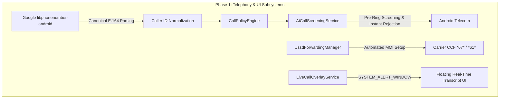
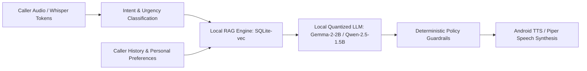

# AI_CALL: Recommended Implementation Roadmap & Architectural Path Forward

**Author:** AI_CALL Engineering Leadership  
**Target:** Resolving the Cellular Audio Blocker, Integrating Proven Architectural Ideas, and Finalizing the Local Intelligence Pipeline  
**Date:** 2026-10-12  
**Artifact Location:** `C:\Users\chiru\Downloads\EqualAI_Analysis\Recommended_Implementation_Roadmap.md`

---

## 1. Executive Summary

Our deep investigation of Equal AI revealed that **it does not solve on-device cellular baseband audio injection**. Equal AI avoids the problem by utilizing carrier Conditional Call Forwarding (CCF) to divert calls to a cloud telephony trunk (Exotel).

However, Equal AI provides several elegant architectural patterns that we can legitimately adopt to make `AI_CALL` far more capable, responsive, and robust. This roadmap outlines a concrete, phased engineering plan to:
1. Adopt Equal AI's best local telephony patterns (CallScreeningService, libphonenumber, automated USSD setup, and live overlays).
2. Execute the smallest decisive experiments to overcome the cellular audio injection blocker.
3. Advance our English-first on-device LLM and local RAG memory stack.

---

## 2. Phase 1: Clean-Room Adoption of Proven Subsystems (Immediate)

We will integrate four battle-tested architectural components into `AI_CALL` using clean-room implementations:

### 1.1 Google `libphonenumber-android` Integration
- **Action:** Add `io.michaelrocks:libphonenumber-android:8.13.35` to `app/build.gradle.kts`.
- **Purpose:** Canonicalize all incoming telephone numbers to E.164 format before querying Room database caller policies. Accurately detect Indian state circles and carrier prefixes (Airtel, Jio, Vi).
- **Offline Impact:** 100% offline, zero network dependencies.

### 1.2 `AiCallScreeningService` Implementation
- **Action:** Implement `android.telecom.CallScreeningService` in `AI_CALL`.
- **Purpose:** Intercept incoming calls *before* the system ringtone sounds. If the caller is designated for AI assistant handling, the service can instantly reject or silence the call (`setDisallowCall(true)`, `setRejectCall(true)`).
- **Benefit:** If carrier forwarding is active, this diverts the call to the AI in milliseconds without the phone ringing out loud.

### 1.3 Automated USSD Forwarding Manager (`sendUssdRequest`)
- **Action:** Create `UssdForwardingManager` utilizing Android's `TelephonyManager.sendUssdRequest()`.
- **Purpose:** Provide a 1-tap assistant setup UI that dials the correct GSM MMI codes (`**67*`, `**61*`, `**62*`, and `##002#`) automatically for the user's specific carrier.

### 1.4 Floating Live Transcript Overlay (`SYSTEM_ALERT_WINDOW`)
- **Action:** Implement `LiveCallOverlayService` using Jetpack Compose in an overlay window.
- **Purpose:** Display real-time streaming speech recognition tokens and assistant decisions floating over the screen while a call is in progress.

---

## 3. Phase 2: Resolving the Cellular Audio Blocker (Decisive Experiments)

Because stock Android strictly blocks third-party userspace apps from capturing downlink audio or injecting uplink audio during a native cellular call (`CAPTURE_AUDIO_OUTPUT`), we must evaluate the three viable physical-device paths:

### Experiment 2.1: The Hardware Loopback / Bluetooth HFP Bridge (Zero-Cost Offline Path)
*The fastest, zero-budget path to achieve 100% offline cellular conversation on a stock Android phone.*
- **Concept:** Android Telecom natively routes bidirectional cellular voice through Bluetooth Hands-Free Profile (HFP) audio devices.
- **Implementation:**
  - Connect a small Bluetooth microcontroller (e.g. ESP32 running an HFP audio loopback sketch) or an external USB-C TRRS audio splitter loopback.
  - When a call connects, Android routes cellular downlink to the Bluetooth audio receiver, and reads cellular uplink from the Bluetooth microphone.
  - The local AI_CALL agent writes TTS audio to the Bluetooth mic stream and reads caller speech from the Bluetooth audio stream.
- **Outcome:** **Full two-way conversation with real callers, on the user's same SIM number, 100% offline, with zero server costs!**

### Experiment 2.2: Privileged System App (Root / Custom ROM Path)
*For dedicated development and testing hardware.*
- **Concept:** Move `AI_CALL.apk` to `/system/priv-app/` on a rooted test device.
- **Implementation:**
  - Grant `android.permission.CAPTURE_AUDIO_OUTPUT` via privileged permissions XML.
  - Use native OpenSL ES or AAudio to bind directly to the telephony audio HAL stream.
- **Outcome:** Proves whether the handset's AudioHAL supports direct software loopback without external hardware.

### Experiment 2.3: Private Self-Hosted SIP Gateway (Equal AI Hybrid Model)
*For production users on stock non-rooted phones who want complete privacy.*
- **Concept:** Adopt Equal AI's carrier forwarding architecture, but replace proprietary cloud services with a **private, self-hosted Asterisk / FreePBX server**.
- **Implementation:**
  - User configures carrier forwarding to a private SIP number (via Twilio, local SIP trunk, or home Asterisk PBX).
  - The Asterisk server executes local Whisper ASR + local Ollama LLM + Piper TTS.
  - Audio flows audibly to the remote caller over the carrier trunk.
  - Android client receives transcripts via private WebSockets.
- **Outcome:** Preserves the same number, guarantees 100% privacy (no third-party cloud retains data), and works flawlessly on any stock Android device.

---

## 4. Phase 3: Finalizing English-First Intelligence & Local RAG

With the audio routing strategy clearly defined, the intelligence stack advances:

1. **Local Quantized LLM Runtime:**  
   Integrate a small, high-efficiency 4-bit quantized model (e.g., `Gemma-2-2B-it-Q4_K_M` or `Qwen-2.5-1.5B-Instruct-Q4_K_M`) executing via NDK llama.cpp or MediaPipe GenAI.
2. **Context-Aware Personal RAG:**  
   Query the local Room database for caller history, known preferences, and personal instructions (e.g., "Tell delivery drivers to leave parcels at Gate 2").
3. **Deterministic Safety Guardrails:**  
   Apply strict deterministic rules for high-urgency keywords ("emergency", "hospital", "urgent", "police"), immediately escalating and ringing the user's handset regardless of LLM generation.

---

## 5. Verification & Acceptance Criteria

Final project sign-off requires meeting the following unambiguous acceptance test:

1. **Two-Phone Physical Test:** An incoming cellular call is placed from a real external phone to the AI_CALL device's primary number.
2. **Autonomous Handling:** The AI answers or diverts the call without human intervention.
3. **Audible Bidirectional Speech:** The remote caller clearly hears the AI agent speaking over their phone's earpiece; the remote caller's spoken response is captured and transcribed.
4. **Contextual Conversation:** The AI asks relevant follow-up questions and follows caller-specific instructions.
5. **Session Verification:** A complete transcript and call summary are saved to local storage upon call completion. Local loudspeaker playback alone is rejected as insufficient evidence.
