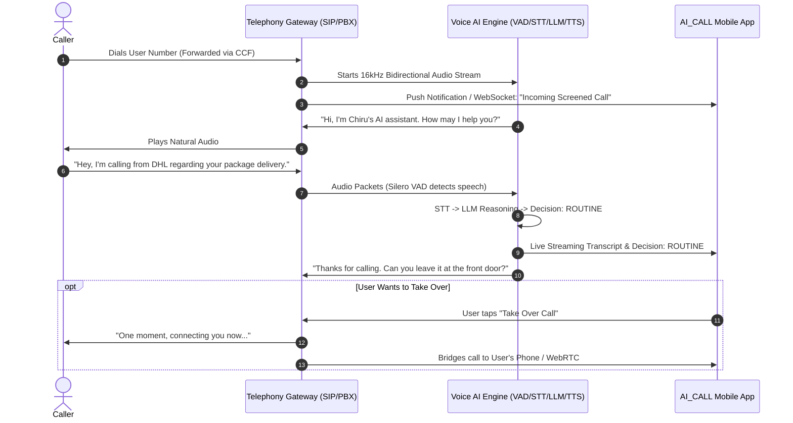

# AI_CALL Architecture: Dual-Mode Operating Model

This document outlines the architectural strategy for AI_CALL, establishing two operating modes based on platform capabilities, telephony realities, and user trust.

---

## 1. Guiding Principles

| Dimension | Principle | Application in AI_CALL |
| :--- | :--- | :--- |
| **Think Humanly** | Empathy & Cognitive Realism | Callers are real people expecting warmth, promptness (<1s turn turnaround), and respect for their time. The device owner needs peace of mind, freedom from spam, and zero fear of missing critical emergencies. |
| **Think Rationally** | Scientific & Engineering Truth | Third-party Android apps cannot intercept cellular voice downlink or inject uplink audio without OEM signature permissions. A genuine cellular agent cannot run purely in Android user-space. |
| **Act Humanly** | Natural Interaction & Restraint | The agent introduces itself honestly, listens attentively, handles interruptions (barge-in) gracefully, and adapts tone based on urgency. |
| **Act Rationally** | Robust Engineering & Safety Policies | Maintain strict safety boundaries: verify uncertainty, refuse unauthorized commitments, escalate medical/financial crises immediately, and record state truthfully. |

---

## 2. Operating Modes Overview

```
                      +---------------------------------------+
                      |           Incoming Caller             |
                      +---------------------------------------+
                                          |
                      +-------------------+-------------------+
                      |                                       |
              (Direct Dial to Device)                 (Carrier CCF Route)
                      |                                       |
                      v                                       v
          +------------------------+             +--------------------------+
          |  MODE 1: On-Device AI  |             |  MODE 2: Gateway Agent   |
          |  (Offline Dialer &     |             |  (Cloud / PBX Telephony) |
          |   Local Intelligence)  |             +--------------------------+
          +------------------------+                          |
                      |                          +------------+------------+
                      |                          | Full-Duplex Audio Stream|
                      |                          |  - Silero VAD (Barge-in)|
                      |                          |  - Streaming STT        |
                      |                          |  - Conversational LLM   |
                      |                          |  - Neural TTS Stream    |
                      |                          +-------------------------+
                      |                                       |
                      |    Encrypted WebSocket / Push Sync    |
                      +<--------------------------------------+
                      |
                      v
          +------------------------+
          |   AI_CALL Android App  |
          |   (User Mission Control|
          |    Transcripts, Room,  |
          |    Takeover, Rules)    |
          +------------------------+
```

---

## 3. Mode 1: On-Device AI (Sovereign Local Hub)

### Purpose
Acts as the user's private, offline-first personal communications manager, custom dialer, and local intelligence engine.

### Preserved Components
- **Native Dialer UI**: Jetpack Compose dialer, call history, and contacts.
- **Local Speech Recognition**: [WhisperSpeechRecognizerEngine](file:///c:/Users/chiru/OneDrive/Desktop/AI_CALL/app/src/main/java/com/aicall/agent/ai/voice/WhisperSpeechRecognizerEngine.kt) running Whisper.cpp quantized models directly on NPU/CPU.
- **Local Policy & Reasoner**: [RiskAndUrgencyAssessor](file:///c:/Users/chiru/OneDrive/Desktop/AI_CALL/app/src/main/java/com/aicall/agent/ai/policy/RiskAndUrgencyAssessor.kt) for rule-based heuristics and offline classification.
- **Caller Memory & State**: Room Database ([CallRecord](file:///c:/Users/chiru/OneDrive/Desktop/AI_CALL/app/src/main/java/com/aicall/agent/data/model/CallRecord.kt)) with local caller profile tracking.
- **Telecom Control**: [CallManager](file:///c:/Users/chiru/OneDrive/Desktop/AI_CALL/app/src/main/java/com/aicall/agent/service/telecom/CallManager.kt) and [AppInCallService](file:///c:/Users/chiru/OneDrive/Desktop/AI_CALL/app/src/main/java/com/aicall/agent/service/telecom/AppInCallService.kt) for native incoming/outgoing call handling.

### Realistic Platform Boundary
- **What it does**: Screens incoming caller ID, matches local contact records, controls ringing/vibration, auto-rejects spam, plays announcements over speaker/Bluetooth when appropriate, and transcribes local voicemails or recorded audio files offline.
- **What it does NOT promise**: Two-way conversational audio on cellular calls. Android OS security blocks non-OEM third-party apps from intercepting cellular voice downlink (`CAPTURE_AUDIO_OUTPUT` restriction) or injecting synthesized audio into the cellular uplink.

---

## 4. Mode 2: Autonomous Call Agent (Telephony Gateway)

### Purpose
Provides genuine, full-duplex, two-way conversational AI screening for real telephone callers dialing the user's mobile number.

### Telephony Ingestion Architecture
1. **Conditional Call Forwarding (CCF)**:
   - **Important Carrier & Regional Caution**: MMI/USSD codes are carrier- and region-dependent. In North America, `*67` prefix blocks Caller ID, whereas standard GSM forwarding uses `**67*<number>#` (Busy), `**61*<number>#` (No Answer), and `**62*<number>#` (Unreachable). 
   - **Recommended Approach**: Never dial codes blindly. Verify the exact forwarding procedure with your specific mobile network operator (e.g., Jio, Airtel, Vi in India), or configure forwarding reliably via the device's native settings: `Phone App -> Settings -> Calling accounts -> Call forwarding`.
2. **SIP / PBX Termination**:
   - The Gateway (e.g., LiveKit SIP, FreeSWITCH, Asterisk, or Twilio) receives the forwarded SIP invite with the original caller's CLI (`From`) and the user's forwarded number (`Diversion` header).
   - Gateway answers the call and opens a bidirectional RTP stream (G.711 / Opus).

### Streaming Pipeline



### Telephony Pipeline Components
1. **Voice Activity Detection (VAD)**: Silero VAD (<30ms latency) with full Barge-In support. If the caller starts speaking while the agent is talking, synthesis halts instantly.
2. **Streaming STT**: Fast streaming speech-to-text (Deepgram Nova-2 / Streaming Conformer / Whisper Live).
3. **Conversational Reasoner**: Low-latency LLM (Gemini 1.5 Flash / Groq Llama-3 / Local vLLM) executing the explicit screening prompt with context memory.
4. **Streaming TTS**: Sub-250ms neural speech synthesis (Cartesia / ElevenLabs / Kokoro-ONNX).
5. **Mobile Bridge**: WebSocket sync pushing live transcription, urgency level, and takeover controls directly to AI_CALL.

---

## 5. Infrastructure & Cost Analysis (Preliminary)

> [!WARNING]
> **Regional Cost & Telephony Disclaimer**:
> The figures below are preliminary international baseline estimates and have **not yet been verified for India**. 
> In India, telephony is governed strictly by the Department of Telecommunications (DoT) and TRAI regulations on VoIP-PSTN interconnect. Procuring local Indian virtual numbers (+91 DIDs) or SIP trunks requires regulatory KYC/business verification and carries distinct per-minute rates (e.g. through Exotel, Plivo, or Twilio India). Actual costs will depend on provider availability, network taxes, model token usage, and speech synthesis quotas.

| Component | Managed Cloud Route (e.g., Twilio + LiveKit Cloud + Hosted AI) | Self-Hosted / Hybrid Route (VPS + FreeSWITCH + BYOK APIs) |
| :--- | :--- | :--- |
| **Telephony Ingress** | Twilio / Telnyx SIP Trunk (~$0.004–$0.0085/min) | Telnyx / Flowroute SIP Trunk (~$0.003/min) |
| **Server / PBX** | Serverless / LiveKit Cloud (~$0.005/session) | Hetzner / DigitalOcean VPS ($10–$20/month flat) |
| **STT Engine** | Deepgram Nova-2 (~$0.0043/min) | Self-hosted Faster-Whisper on GPU VPS OR Deepgram API |
| **LLM Inference** | Gemini 1.5 Flash (~$0.001/call) | Groq / Gemini 1.5 Flash (~$0.001/call) |
| **TTS Engine** | Cartesia / ElevenLabs (~$0.015/min) | Kokoro-ONNX (Local/Free CPU) or Cartesia |
| **Estimated Cost per 1-min Call** | **~$0.03 – $0.05 / call** *(Unverified for India)* | **~$0.005 – $0.015 / call** (+ $15/mo VPS) *(Unverified for India)* |
| **Maintenance Burden** | Zero server maintenance, turnkey scalability | Requires managing SIP server, SSL, firewall, uptime |

---

## 6. Implementation Milestones

### Phase 1: Mode 1 Hardening (Complete & Preserved)
- Android native dialer, [CallManager](file:///c:/Users/chiru/OneDrive/Desktop/AI_CALL/app/src/main/java/com/aicall/agent/service/telecom/CallManager.kt), and [ConversationManager](file:///c:/Users/chiru/OneDrive/Desktop/AI_CALL/app/src/main/java/com/aicall/agent/ai/conversation/ConversationManager.kt) are verified.
- Direct cellular calls without intercepted audio record strictly as `MISSED` with `NOT_ASSESSED` risk. No changes to the existing UI or Room DB.

### Phase 2: Isolated Standalone Proof of Concept (Next Step)
Before any code is connected to the production Android app, build a **small, completely isolated proof of concept** (e.g., in a dedicated tools directory):
- **Test Ingress**: Receive a test call through a supported telephony gateway.
- **Audio Capture**: Capture actual caller audio stream (RTP/PCM).
- **Transcribe**: Convert speech to text via streaming STT.
- **Reason**: Generate a contextually appropriate response using the conversational reasoner.
- **Synthesize & Playback**: Synthesize audio via TTS and inject it directly back into the live call stream.
- **Verification**: Verify that the caller clearly hears the synthesized speech in real-time.
- **Telemetry**: Log timestamps, end-to-end turn latency, audio packet loss, and errors.
- **Isolation Guarantee**: Zero modifications to the Android app, dialer, Room database, or UI during this phase.

### Phase 3: Mobile Cockpit Integration (Future)
- Once two-way audio is proven end-to-end, introduce the secure sync bridge to AI_CALL for live streaming transcripts, telemetry, and call takeover.
   - Display real-time streamed calls, summaries, risk decisions, and the "Take Over" action.
