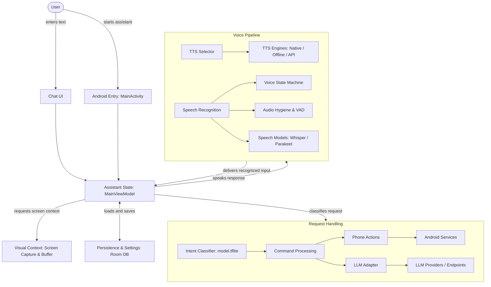

# AI_CALL — Reference Reuse & Architectural Assessment

## 1. Overview & Objective Alignment

The primary goal of **AI_CALL** is an **AI-powered personal call agent that handles calls to the user's existing phone number through native cellular telephony**.

This document assesses two external reference codebases alongside architectural diagrams to derive reusable components for AI_CALL:
1. **Reference A**: Offline voice assistant source (`C:\Users\chiru\Downloads\ai-assistant-android-main\ai-assistant-android-main`)
2. **Reference B**: Secure Dialer UI source (`C:\Users\chiru\Downloads\Secure-Dialer-main\Secure-Dialer-main`)
3. **Reference C**: System architecture diagrams supplied in conversation.

---

## 2. Telephony Boundary & Audio Reality Check

| Dimension | Ordinary Microphone Loop | Cellular Call Ingestion |
| :--- | :--- | :--- |
| **Input Source** | `AudioRecord` with `MediaRecorder.AudioSource.VOICE_COMMUNICATION` captures the **physical near-field microphone** of the phone. | Cellular voice downlink audio (`VOICE_DOWNLINK`, `VOICE_CALL`) is restricted on standard Android by the platform permission `android.permission.CAPTURE_AUDIO_OUTPUT` (system/signature level only). |
| **Output Sink** | `AudioTrack` with `USAGE_VOICE_COMMUNICATION` / `USAGE_MEDIA` plays out through the speaker, earpiece, or Bluetooth headset. | Injecting synthesized audio into cellular uplink (`VOICE_UPLINK`) is prohibited for third-party non-OEM user-space applications. |
| **Target Device State** | iQOO Z9 5G (`10BE7U31G8000R6`), Android 16 (API 36 Baklava, FuntouchOS 16.2), arm64-v8a. | Device empirical check confirms `com.aicall.agent.debug` holds `android.app.role.DIALER`. However, **being default dialer does NOT grant audio stream interception or injection permissions**. |
| **Impact on Architecture** | Suitable for on-device voice interaction (Mode 1), hands-free testing, local diagnostics, and caller voicemail transcription. | Genuine full-duplex cellular screening (Mode 2) requires the carrier forwarding (CCF) telephony gateway as established in [dual-mode-operating-model.md](../architecture/dual-mode-operating-model.md). |

---

## 3. Architecture Diagram Mapping (Reference C to AI_CALL)

The supplied architecture diagrams illustrate the relationship between user interaction, assistant state, visual context, request handling, persistence, and the voice pipeline.

### Component Responsibility & Mapping Table

| Diagram Responsibility | Reference Implementation (A) | AI_CALL Existing Component | Evaluation & Planned Action |
| :--- | :--- | :--- | :--- |
| **User Interaction** | `ChatScreen.kt`, Compose UI | `DialerScreen.kt`, `DashboardScreen.kt`, `IncomingCallScreen.kt`, `OngoingCallScreen.kt` | **Adapt to Secure Dialer UI**: Replace existing Google-Phone mockup screens with Secure Dialer's rich Jetpack Compose interface. |
| **Assistant State** | `MainViewModel.kt` | `ConversationManager.kt`, Telecom `CallManager.kt` | **Preserve**: Keep AI_CALL's state machine, Telecom lifecycle, and caller memory context. |
| **Persistence & Settings** | Room DB, `Encrypted conversations`, `SettingsRepository` | Room DB (`CallRecord`, `CallerProfile`, `AppDatabase`), `AgentConfigRepository` | **Preserve**: Keep AI_CALL Room entities. Secure Dialer's settings will be mapped to AI_CALL preferences. |
| **Visual Context** | `ScreenCaptureService.kt`, `ScreenCaptureServiceHelper.kt` | None | **Reject / Exclude**: Screen frame buffer and projection capture are unnecessary for telephony screening and introduce heavy battery drain and privacy risks. |
| **Intent Classification** | `TextClassifierHelper.kt` (MediaPipe MobileBERT `model.tflite`, 26 MB) | `RiskAndUrgencyAssessor.kt`, `PolicyEnforcer.kt` | **Preserve AI_CALL Heuristics**: AI_CALL uses deterministic rule heuristics and LLM reasoning. MediaPipe classification is not required. |
| **Command Processing** | `ProcessChatCommandUseCase.kt`, `CallContactUseCase.kt` | `CallManager.kt`, `PhoneNumberUtils.kt`, `AppInCallService.kt` | **Preserve AI_CALL Telecom Actions**: Disconnecting, holding, answering, and caller memory updating. |
| **LLM Adapter & Providers** | `GetAiResponseUseCase.kt`, Groq / OpenAI HTTP adapters | `RuleBasedReasoningEngine.kt`, `LlmReasoningEngine.kt`, Gateway LLM | **Preserve AI_CALL Engine**: Deterministic offline policy enforcement + local reasoning. |
| **TTS Selector & Engines** | `TtsEngineSelector.kt`, `NativeTtsManager.kt`, `OfflineTtsManager.kt` | `SpeechSynthesizerEngine.kt` (`AndroidTtsEngine`) | **Adopt NativeTtsManager Hardening**: Incorporate `activeUtterances` tracking, utterance queuing, and sentence pipelining. Defer large neural TTS download. |
| **Speech Recognition** | `SpeechRecognizerManager.kt` (Parakeet 0.6B / Groq Whisper) | `WhisperSpeechRecognizerEngine.kt` (`whisper.cpp` arm64) | **Bridge Pipeline**: Connect audio recording buffer to Whisper.cpp rather than downloading 652 MB Parakeet model. |
| **Audio Processing & VAD** | `AudioHygieneProcessor.kt` (AEC/NS/AGC), `VadIntelligenceProcessor.kt` | Gateway Python VAD only | **Adopt AudioHygiene & State Machine**: Adapt hardware AEC, NS, AGC effects and deterministic state machine. |
| **Cellular Telephony** | N/A (Ordinary mic only) | `AppInCallService.kt`, `AppCallScreeningService.kt`, `CallManager.kt` | **Preserve Native Core**: Keep Telecom InCallService intact. |

---

## 4. Component Evaluation Matrix (Reference A: Offline Assistant)

| Component | LOC | Models & Size | Memory (RAM) | Dependencies | Licensing | Reuse Decision |
| :--- | :--- | :--- | :--- | :--- | :--- | :--- |
| **`AudioHygieneProcessor.kt`** | 209 | None (0 MB) | < 2 MB | Android SDK (`AudioRecord`, `audiofx.*`) | MIT | **Adopt**: Pure Android SDK, captures 16kHz mono PCM, enables hardware `AcousticEchoCanceler`, `NoiseSuppressor`, and `AutomaticGainControl`. |
| **`VoiceStateMachine.kt`** | 126 | None (0 MB) | Negligible | Pure Kotlin | MIT | **Adopt**: Thread-safe turn state machine (`IDLE` $\leftrightarrow$ `LISTENING` $\leftrightarrow$ `PROCESSING` $\leftrightarrow$ `BOT_SPEAKING`), 300ms acoustic echo transient suppression, barge-in detection. |
| **`NativeTtsManager.kt`** | 163 | None (0 MB) | < 5 MB | Android `TextToSpeech` | MIT | **Adopt**: Solves Android TTS initialization races via `pendingUtterances` buffer and multi-utterance completion via `ConcurrentHashMap`. |
| **`VadIntelligenceProcessor.kt`** | 98 | `silero_vad.onnx` (1.8 MB) | ~15–25 MB | `sherpa-onnx` Vad | MIT | **Selective Adoption**: Keep the adaptive EMA noise floor tracking ($\alpha=0.05$) and dynamic SNR validation. |
| **`OfflineTtsManager.kt`** | 398 | Supertonic 3 (~100 MB bz2) | ~150–250 MB | `sherpa-onnx` OfflineTts | MIT / Apache 2.0 | **Defer Model, Adopt Pipelining**: Model download and native `tar -xjf` extraction are heavyweight and fragile across Android OEM ROMs. Borrow sentence-splitting and `AudioTrack.MODE_STREAM` pattern. |
| **`SpeechRecognizerManager.kt`** | 690 | Parakeet (652 MB) | ~700–1200 MB | Sherpa-ONNX, OkHttp, Groq API | MIT | **Architecture Blueprint Only**: Connect audio frames to AI_CALL's existing Whisper.cpp engine instead of downloading Parakeet or sending audio to Groq. |
| **`SpeechModelManager.kt`** | 198 | Remote URLs | N/A | OkHttp3 | MIT | **Reject**: 663 MB download over cellular violates instant dialer performance. |
| **`TextClassifierHelper.kt`** | 118 | `model.tflite` (26 MB) | ~50 MB | MediaPipe tasks-text | Apache 2.0 | **Reject**: MediaPipe intent routing is redundant with AI_CALL's existing reasoning engine. |

---

## 5. Technical Conflict & Compatibility Analysis

1. **Package Namespace**:
   * Reference A uses `com.app.assistant.*`.
   * Reference B uses `com.example.*`.
   * AI_CALL uses `com.aicall.agent.*`.
   * *Resolution*: All imported and adapted code must be mapped into `com.aicall.agent.*`.
2. **Kotlin & Compiler Compatibility**:
   * Reference A uses Kotlin 1.9.0 + Compose Compiler 1.5.1 + `kapt`.
   * Reference B uses Kotlin 2.0.20 + Kotlin Compose Plugin + `ksp`.
   * AI_CALL uses Kotlin 2.0.20 + Kotlin Compose Plugin + `ksp` (2.0.20-1.0.25).
   * *Resolution*: Match AI_CALL's modern Kotlin 2.0.20 / KSP environment. Deprecated coroutine constructs like `newSingleThreadContext` in Reference A will be updated to `Dispatchers.Default.limitedParallelism(1)`.
3. **Android SDK & ABI Restrictions**:
   * AI_CALL enforces `compileSdk = 34`, `minSdk = 26`, `targetSdk = 33`, `ndk.abiFilters.add("arm64-v8a")`.
   * Reference B targets SDK 36.
   * *Resolution*: Keep AI_CALL at compileSdk 34 (or 35 if needed for specific APIs). Ensure all native code strictly targets `arm64-v8a` to match physical test device (`MT6886`).
4. **Lifecycle & Background Handling**:
   * Reference A binds to `ComponentCallbacks2.TRIM_MEMORY_UI_HIDDEN` to stop recording.
   * In AI_CALL, in-call screening persists in foreground services (`AppInCallService`) while the screen is locked or the app is minimized.
   * *Resolution*: Decouple audio recorder lifecycle from UI visibility; tie it to the telecom call lifecycle and explicit user test controls.
