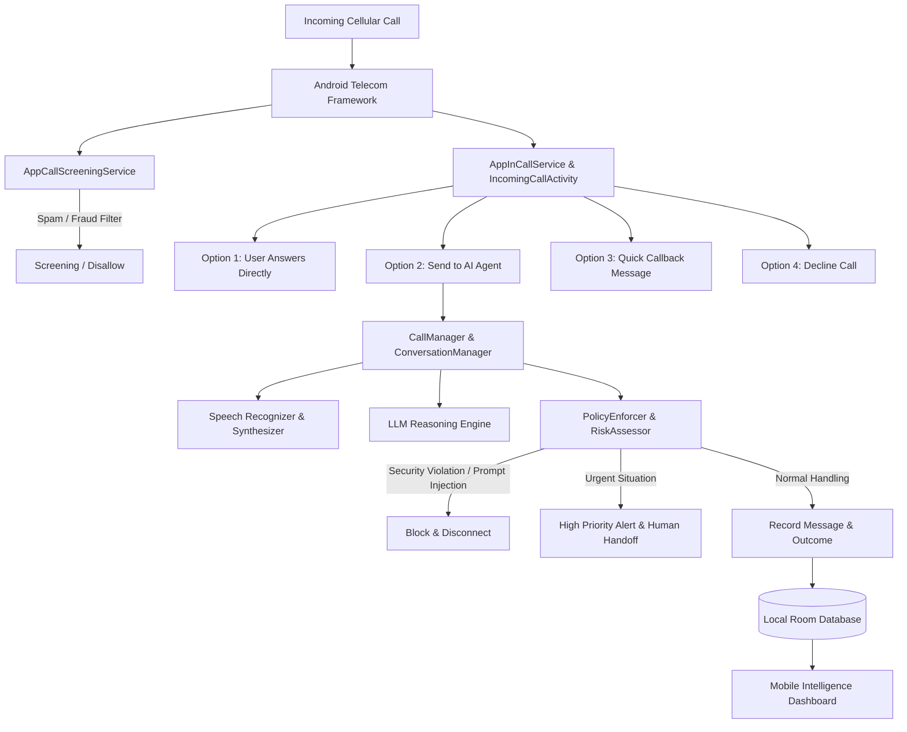

# AI Personal Call Agent — System Architecture & Walkthrough

Welcome to the comprehensive walkthrough of **AI Personal Call Agent**, a production-oriented native Android application built in Kotlin, Jetpack Compose, Android Telecom Framework, Room Database, and an intelligent autonomous call-handling agent.

---

## 1. High-Level Architecture Overview

The application unites three core systems inside **one unified native Android app**:
1. **Native Android Telecom Dialer**: Replaces the default phone app with a modern dialpad, call history, contacts, and in-call controls.
2. **Autonomous AI Call Agent**: Converses with callers, understands intent, handles ordinary queries from approved knowledge, and escalates emergencies.
3. **Mobile Intelligence Dashboard**: In-app analytics, speaker-labeled transcripts, AI summaries, extracted follow-up action items, and fraud/risk assessments.



---

## 2. Tour of Application Modules & Screens

### 📱 A. Native Dialer (`DialerScreen.kt`)
- **Default Phone Role Onboarding**: Detects whether the app holds the `RoleManager.ROLE_DIALER` role on Android 10+ (API 29+) and renders a one-tap authorization banner.
- **Recents Call Stream**: Displays all incoming, outgoing, AI-handled, and missed cellular calls with categorical badges (e.g., `COLLEGE`, `DELIVERY`, `FAMILY`, `SPAM`).
- **Keypad & Speed Dial**: Interactive dialpad with DTMF feedback, digit formatting, backspace, and direct cellular dialing using `TelecomManager` & `Intent.ACTION_CALL`.

### 📞 B. Incoming Call Experience (`IncomingCallActivity.kt` & `IncomingCallScreen.kt`)
- Supports wake-up and lock-screen display (`showWhenLocked="true"`, `turnScreenOn="true"`).
- Presents **4 explicit user choices**:
  1. **Send to AI Agent**: Immediately connects the cellular call to the autonomous voice agent with live transcript streaming.
  2. **Answer Directly**: Traditional human cellular call connection.
  3. **Send Quick Callback Note**: Rejects with pre-configured automated callback response.
  4. **Decline**: Standard call rejection.

### 🎙️ C. Ongoing Call & Live Agent Experience (`OngoingCallScreen.kt`)
- **Live Conversation Stream**: When AI handles the call, the user sees a real-time, speaker-labeled dialogue (`Caller` vs `AI`) updated turn-by-turn.
- **Seamless Call Takeover**: One-tap "Take Over Call Directly" button allows the human user to instantly jump in and take over the call from the AI agent.
- **Standard Controls**: Mute, Speakerphone, Keypad overlay, and End Call.

### 📊 D. Mobile Intelligence Dashboard (`DashboardScreen.kt` & `CallDetailScreen.kt`)
- **KPI Metrics**: Real-time counters for Total Calls, AI-Handled Calls, User Answered, Missed, Urgent Alerts, and Suspected Spam/Fraud.
- **Search & Multidimensional Filtering**: Instant search by caller name, number, intent keywords, urgency, or category.
- **Follow-Up Action Items**: Auto-extracted tasks (e.g., "Collect Amazon parcel from security", "Urgent callback needed for college office") with interactive checkboxes.
- **Call Detail View**: Speaker-labeled transcripts, AI-extracted summaries, caller verification status, risk scores, and cell location approximation.

### 🧠 E. AI Agent Controls & Safety Rules (`AgentControlsScreen.kt`)
- **Operating Modes**:
  - **Manual Mode**: Instant toggle to enable/pause autonomous call handling.
  - **Scheduled Mode**: Configure weekly schedules with start/end times and midnight-crossing support.
- **Multilingual Selection**: Native support for **Telugu-English code-switching**, **English**, **Telugu**, and **Hindi**.
- **Approved Knowledge Base**: User-editable profile specifying what the AI is permitted to disclose.
- **Deterministic Policy Enforcement (`PolicyEnforcer.kt`)**:
  - **OTP & Credential Defense**: Unconditionally blocks attempts by callers to elicit passwords, OTPs, PINs, or banking details.
  - **Prompt Injection Defense**: Detects and neutralizes adversarial caller phrases (e.g., *"Ignore previous instructions"*, *"System prompt override"*).

### 🛠️ F. Telephony Feasibility & Diagnostics (`DiagnosticsScreen.kt`)
- Evaluates device capability matrix in compliance with Android Telecom specifications:
  - Default Phone App & InCallService: **Implemented & Tested**
  - Call Screening Service & Spam Gating: **Implemented & Tested**
  - Automated Answering & State Handoff: **API Supported / Ready to Test**
  - Two-Way Cellular Audio Injection: **Requires Real-Device Cellular Testing**
  - Urgent Alerts & DND Override: **Implemented & Tested**
  - Battery Optimization & Wake Lock: **Implemented & Tested**

---

## 3. Project Directory Map

```
c:\Users\chiru\OneDrive\Desktop\AI_CALL\
├── app\
│   ├── build.gradle.kts                          # App dependencies (Compose, Room, Telecom, KSP)
│   ├── proguard-rules.pro
│   └── src\
│       ├── main\
│       │   ├── AndroidManifest.xml               # InCallService, CallScreeningService, Permissions
│       │   ├── res\                              # Strings, Colors, Themes, Vector Drawables
│       │   └── java\com\aicall\agent\
│       │       ├── AiCallApp.kt                  # Application class (Room DB, Notification Channels)
│       │       ├── service\telecom\
│       │       │   ├── AppInCallService.kt       # Android Telecom InCallService
│       │       │   ├── AppCallScreeningService.kt# Pre-answer spam screening
│       │       │   └── CallManager.kt            # Core telephony coordinator & audio router
│       │       ├── data\
│       │       │   ├── model\                    # CallRecord, CallerProfile, AgentRule, ActionItem
│       │       │   ├── db\                       # AppDatabase, DAOs, Room TypeConverters
│       │       │   └── repository\               # CallRepository, CallerMemoryRepository, AgentConfig
│       │       ├── ai\
│       │       │   ├── voice\                    # STT & TTS interfaces (AndroidTtsEngine)
│       │       │   ├── conversation\             # ConversationManager, LlmReasoningEngine
│       │       │   └── policy\                   # PolicyEnforcer, RiskAndUrgencyAssessor
│       │       └── ui\
│       │           ├── MainActivity.kt           # Main launcher & Telecom dialer activity
│       │           ├── navigation\               # AppNavigation, Screen routes
│       │           ├── theme\                    # Color, Type, Theme (Dark palette)
│       │           ├── dialer\                   # DialerScreen, Dialpad, Recents
│       │           ├── incall\                   # IncomingCallActivity, OngoingCallActivity
│       │           ├── dashboard\                # DashboardScreen, CallDetailScreen
│       │           ├── agent\                    # AgentControlsScreen
│       │           ├── diagnostics\              # DiagnosticsScreen
│       │           └── settings\                 # SettingsScreen
│       └── test\java\com\aicall\agent\
│           ├── PolicyEnforcerTest.kt             # Security & injection tests
│           └── RiskAndUrgencyAssessorTest.kt     # Multilingual urgency & fraud tests
├── build.gradle.kts                              # Root Gradle build script
├── settings.gradle.kts                           # Module definitions & repositories
├── gradle.properties                             # JVM args, AndroidX, SDK auto-download
└── gradlew.bat                                   # Windows Gradle wrapper script
```

---

## 4. Next Steps for Real Device (Android 13) Testing

1. Connect target Android 13 smartphone via USB with **USB Debugging enabled**.
2. Run `adb install -r app/build/outputs/apk/debug/app-debug.apk` to install the APK.
3. Open the app, grant phone & notification permissions, and tap **"Set Default Phone App"** on the banner.
4. Conduct real cellular test calls:
   - **Test 1**: Normal human-to-human call (dialing, answering, declining, mute, speaker).
   - **Test 2**: Tap "Send to AI Agent" on an incoming call and verify automated conversational turns.
   - **Test 3**: Tap "Take Over Call" during AI handling to verify clean handoff.
   - **Test 4**: Check Dashboard to verify persistent call records, summaries, and action items.
